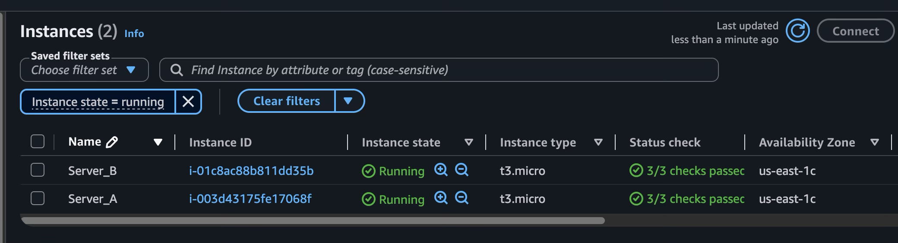

### Perfectly fine servers



Say, we have two functioning EC2 instances:
- **Server_A:** Target Server (The server that will be corrupted)
- **Server_B:** Helper/Rescue Server (The server used for offline repair)

### Breaking the Target Server

Now, we'll intentionally corrupt the boot path configuration on **Server_A**.

**Warning:** Do not attempt this in a production environment!

```powershell
# 1. Force the bootloader to point to a non-existent binary path
bcdedit /set {default} path \Windows\System32\winload_broken.exe

# 2. Prevent automated repair mode loop
bcdedit /set {default} recoveryenabled No

# 3. Force restart
Restart-Computer -Force