This document outlines the step-by-step process for aggregating AWS Config data across all child accounts in the organization. This setup enables Team X to query and export a unified inventory of all managed AWS resources by tag (e.g., `Owner=Girish` or `Team=X`) without requiring direct API calls or Payer/Audit account access.

> **Cost Note:** AWS Organizations, IAM Identity Center, and Config Aggregators are free features. Config charges only apply to resource changes recorded in child accounts ($0.003/CI), which are covered under promotional credits.

---

## Architecture Overview & Best Practices

1. **Dedicated Management Account:** Always create your AWS Organization in a dedicated Management (Master) Account. In accordance with AWS best practices, this account should be reserved strictly for billing and organization governance—do not run application workloads or host central tooling here.
2. **Delegated Administration:** The Management Account is used only to establish the organization and delegate AWS Config permissions. The central Config Aggregator itself will live in Team X’s dedicated operations/tooling account.

---

## Prerequisites: Verifying Promotional Credits

Before deploying resources, verify that your account has active AWS promotional credits to cover any AWS Config recording fees:

1. Open **Billing and Cost Management** in the AWS Console.
2. In the left menu, select **Credits**.
3. Confirm that **AWS Config** and **Amazon Simple Storage Service (S3)** are listed under eligible credit services.

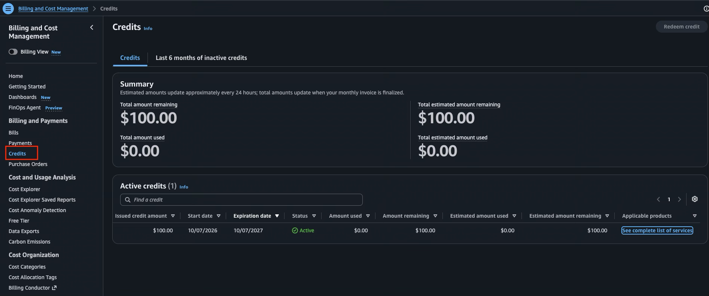

---

## Step 1: Setting Up the AWS Organization

Before aggregating resource data, establish the organization structure to group your child accounts under a single root.

1. Open the AWS Management Console and navigate to **AWS Organizations**.
2. Click **Create an organization**.

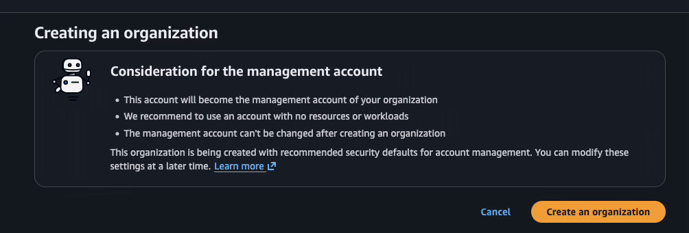

3. Review the management account considerations prompt and click **Create organization**.

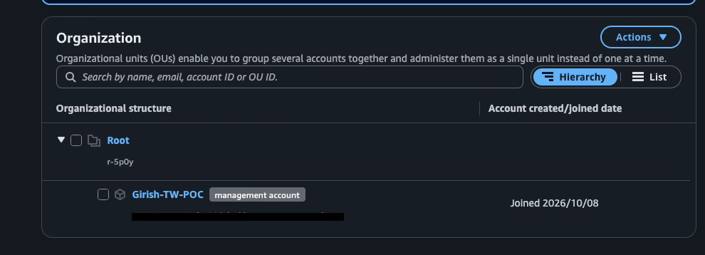

---

## Step 2: Creating Child Accounts

Once the AWS Organization is active, provision your workload child accounts:

1. In the **AWS Organizations** console, navigate to **AWS accounts** and click **Add an AWS account**.
2. Select **Create an AWS account** and enter the **AWS account name** and **Root email address**.

> **Pro Tip (Email Aliases):** You do not need separate email inboxes for each account. Use email sub-addressing (`+` aliasing) with your main email address (e.g., `user+accountA@domain.com` and `user+accountB@domain.com`). All AWS communications will route to your main inbox.

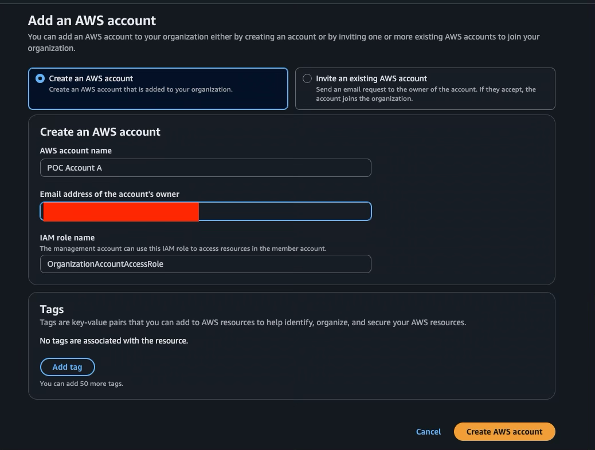

3. Click **Create AWS account**.
4. Refresh the AWS Organizations account list page. The new child accounts will transition from creation to `Active` status under your organizational root.

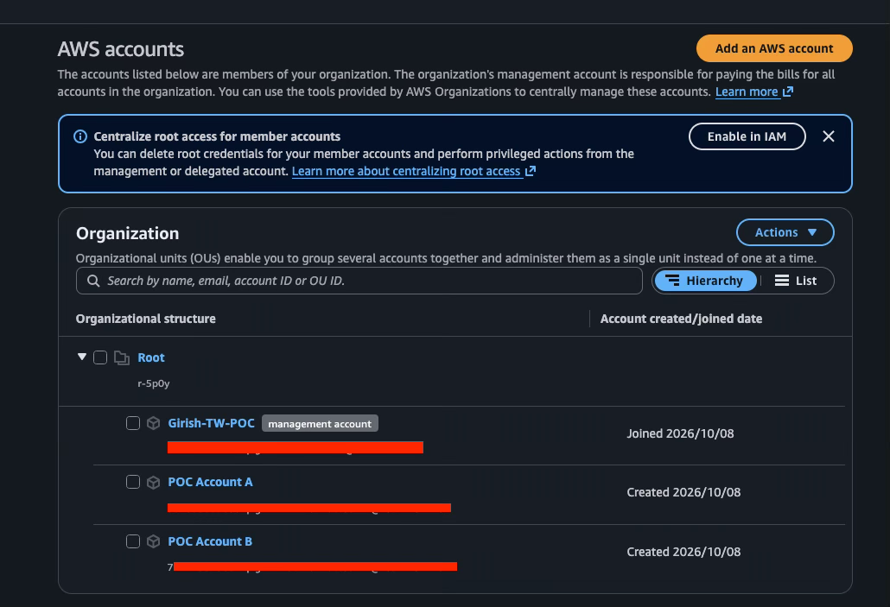

---

## Step 3: Enabling IAM Identity Center (Single Sign-On)

To follow AWS security best practices and avoid using the Root account for daily operations, enable **IAM Identity Center** to manage administrative access across all accounts.

1. Search for **IAM Identity Center** in the Management Account console and click **Enable** $\rightarrow$ **Enable with AWS Organizations**.

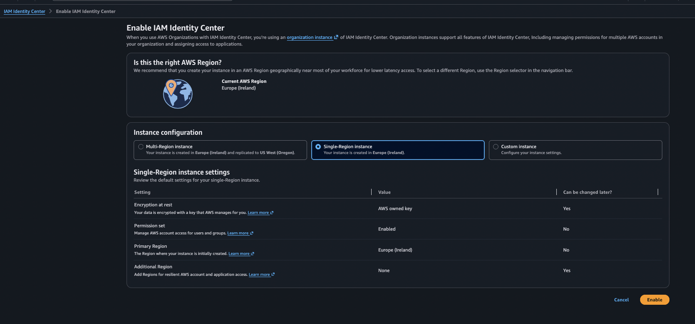

2. **Create Administrative User:**
   * Go to **Users** $\rightarrow$ **Add user**.
   * Enter details (e.g., `admin-girish`) and assign your email address to receive the password setup invitation.

> *Note:* When you first log into the AWS Access Portal with this user, no accounts will be visible yet because access permissions have not been assigned.

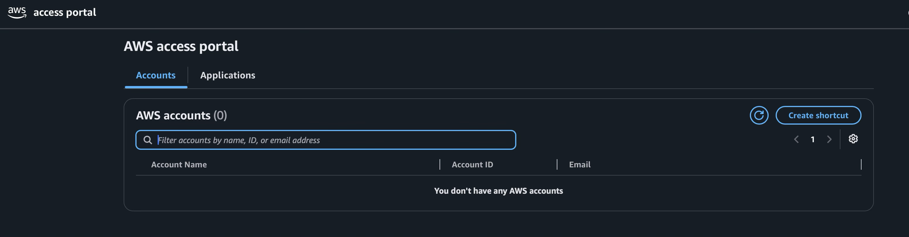

3. **Create Permission Set:**
   * Navigate to **Permission sets** $\rightarrow$ **Create permission set**.
   * Select **Predefined permission set** and choose **`AdministratorAccess`**.

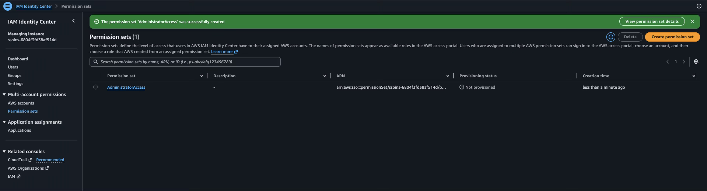

4. **Assign User to Accounts:**
   * Navigate to **AWS accounts** in the left sidebar.
   * Select your target AWS accounts (or the entire Organization root) and click **Assign users or groups**.
   * Select user `admin-girish` and assign the `AdministratorAccess` permission set.

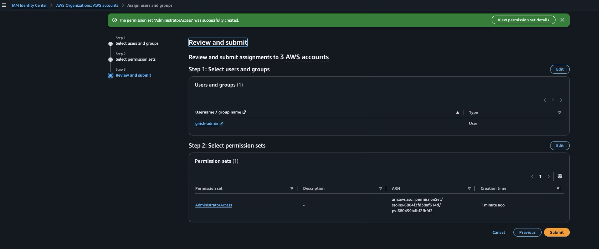

5. **Verify Access:**
   * Open your custom **AWS Access Portal URL** and log in.
   * Refresh the portal page. You will now see all assigned AWS accounts and can access their Management Consoles in one click.

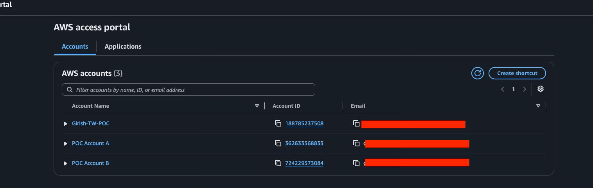

---

## Step 4: Enabling AWS Config in Member Accounts

Set up the AWS Config configuration recorder in each account (including all child accounts and the management account if tracking resources there):

1. Switch to the target account console via the AWS Access Portal.
2. Search for and open **AWS Config**.
3. Click **Get started** or **Set up AWS Config**.
4. Under **Recording strategy**, choose **Specific types** (to keep costs near zero) and select `AWS::S3::Bucket` (or choose *All resource types* for full discovery).
5. Under **Recording frequency**, select **Daily** or **Continuous**.
6. Under **Data delivery**, allow AWS Config to create an Amazon S3 bucket for configuration history delivery.

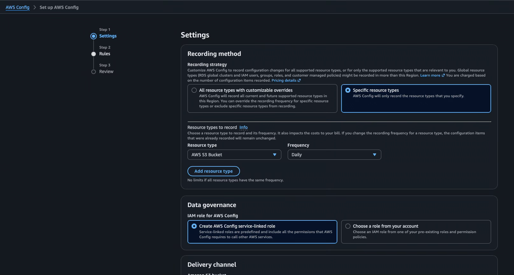

7. Skip adding managed rules on the next screen and click **Confirm**.

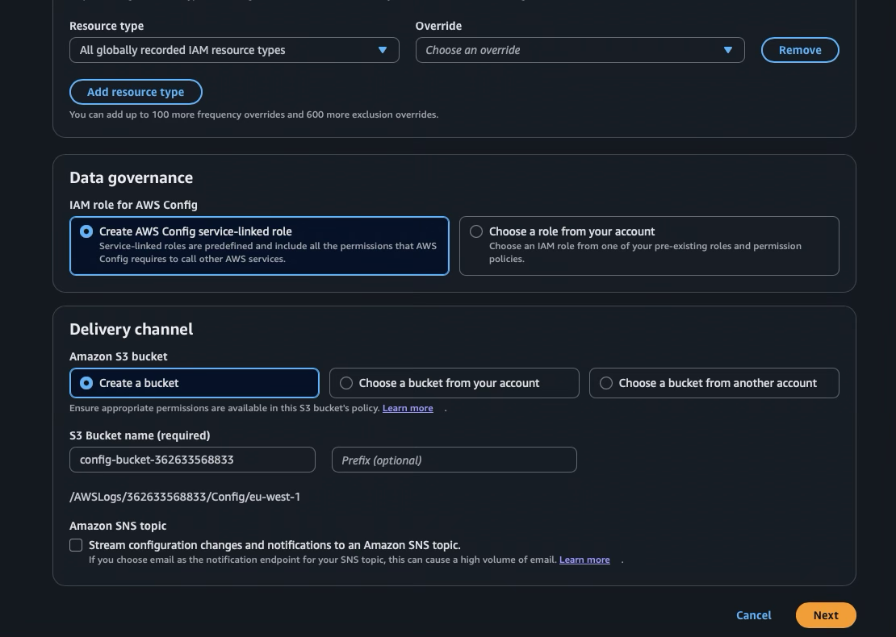

> **Repeat Step 4** across all target accounts in your organization.

### Verification
Go to **AWS Config** $\rightarrow$ **Settings** in each account and confirm the **Recorder status** shows **ON**.

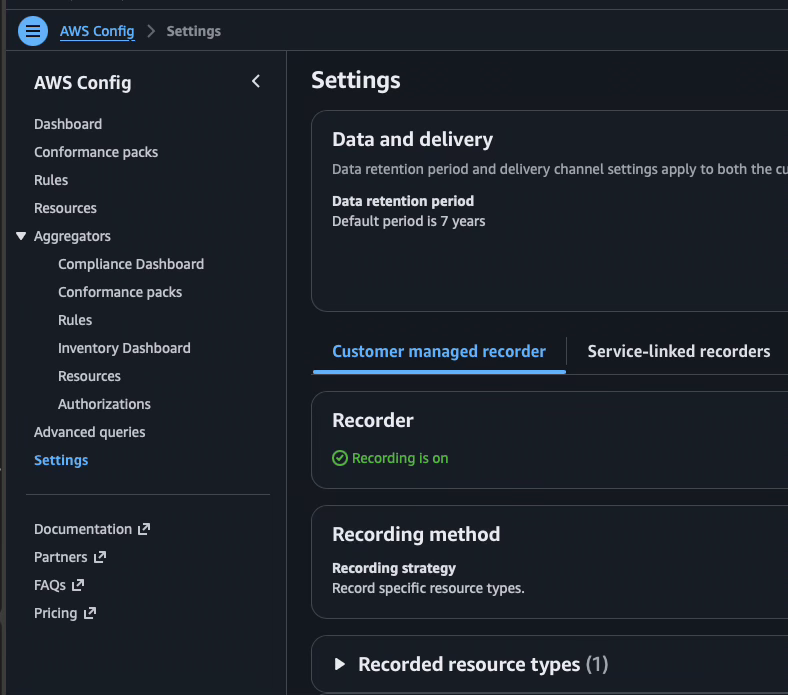

---

## Step 5: Creating the Config Aggregator in the Management Account

Set up the central aggregator to collect configuration inventory across all organizational accounts:

1. Log into your **Management Account** console.
2. Navigate to **AWS Config** $\rightarrow$ **Aggregators** $\rightarrow$ **Create aggregator**.
3. Check the box: **"Allow AWS Config to replicate data from source account(s)"**.
4. Enter an **Aggregator name** (e.g., `POC-TW`).
5. Under **Select source accounts**, choose **Add my organization**.
6. Under **IAM Role**, select **Create a role** so AWS Config receives read permissions across your organization.
7. Under **Regions**, select **Include all regions** (or specify active testing regions, e.g., `eu-west-1`).
8. Click **Create**.

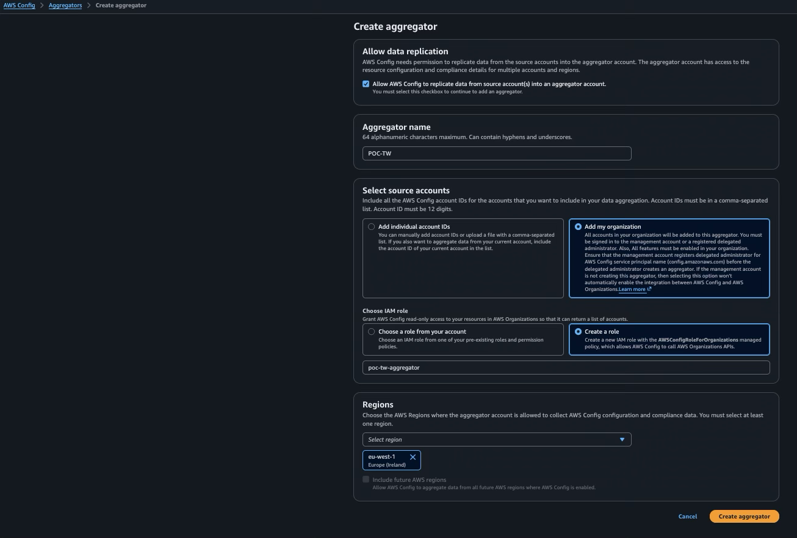

### Verification
Check the Aggregator list view; the status will briefly display `Creating` before transitioning to `Active`.

---

## Step 6: Running Tag Queries Across All Accounts

Verify that resources from all child accounts appear in your central query view:

1. Remaining in your Management Account, open **AWS Config** $\rightarrow$ **Advanced queries**.
2. Change the **Query scope** dropdown from *This account* to your aggregator (`POC-TW`).
3. Enter the following SQL query into the editor:

```sql
SELECT
  accountId,
  awsRegion,
  resourceType,
  resourceId,
  resourceName,
  tags
WHERE
  tags.key = 'Owner'
  AND tags.value = 'Girish'